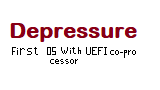
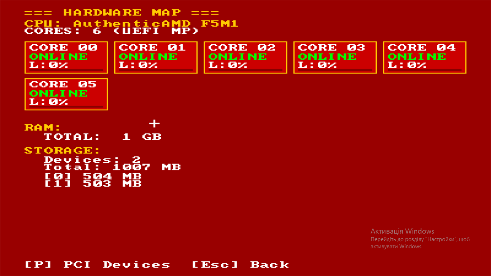
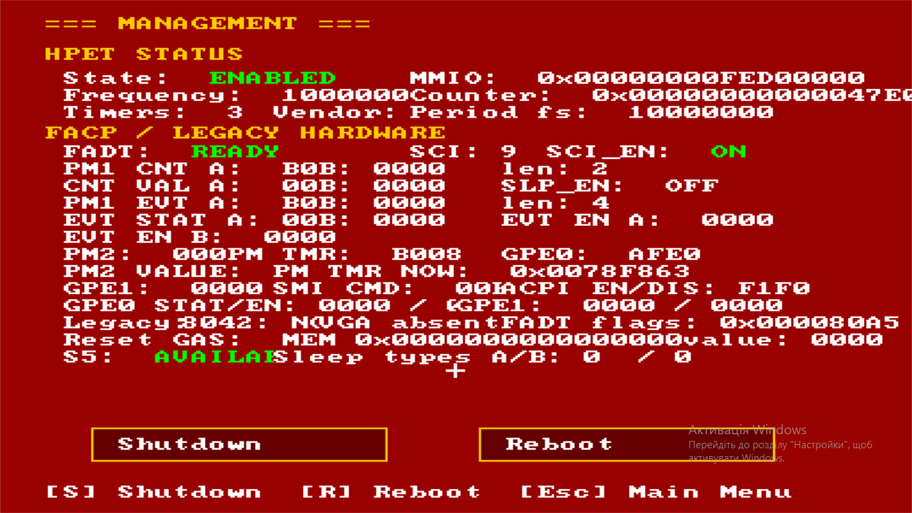

# Depressure - A lightweight OS that runs without `ExitBootServices` and use UEFI as everything

Don't spam that kernel is not lightweight (DEPRESSURE.ELF is 2MB+), is scam, real weight of kernel smaller, this is a compiler error.

## How to build?
Download for Releases zip with OVFM, mingw64 and ELF_Tools, unpack zip in folder with `Depressure`, and bun `build.bat` to check a correct unpacking. Yet, i use files for building (GCC, MingW64) from some GitHub's repos, sorry i lost his nicknames, but if found, i edit README.

## How to use?
Idk how to use that, but you can write your drivers for make from this kernel everything for your tasks. See everything about OS at Wiki. Yet is short readme because i hate to make giant spaghetti-text in README.MD.

## Some screens

